# Guia de apresentação — ICEIBank

Roteiro para apresentar o projeto ao professor: **o que foi feito em cada ponto, qual tela mostrar e
onde está no código**. Os links de código abrem o arquivo direto na linha (no GitHub).

> Ordem sugerida (~10 min): 1) visão geral e pastas → 2) Sprint 1 → 3) Sprint 2 → 4) Sprint 3 →
> 5) testes. Se der para rodar ao vivo, cada sprint tem o seu atalho: `scripts\sprint-1.bat`,
> `sprint-2.bat` e `sprint-3.bat`, um de cada vez (ver `README.md`); se não, use
> os prints desta página.

---

## 1. Visão geral (o que falar primeiro)

"É um banco dividido em **3 agências**. Cada agência é o **mesmo programa Java** rodando 3 vezes,
cada uma dona de uma fatia das contas (**conta `id % 3`**). Quando o dinheiro cruza de uma agência
para outra, aparecem os problemas de sistemas distribuídos que a disciplina estuda."

```
                 Frontend web (02)                App Flutter (03)
                 localhost:5500                   celular/emulador
                        \                              /
                         \---- HTTP + JWT ------------/
                          |            |            |
                     Agência 0    Agência 1    Agência 2      (01 - backend Java)
                     porta 4145   porta 4146   porta 4147
                     contas 0,3,6 contas 1,4,7 contas 2,5,8
                          \            |            /
                           \---- RabbitMQ (créditos entre agências) ----/
                           \---- /bully/* (eleição de líder) -----------/
```

### Organização das pastas (mostrar no explorador de arquivos)

| Pasta | O que é | Sprint |
|---|---|---|
| `01-backend-agencias/` | Serviço REST Java/Spring Boot de uma agência (roda 3x) | 1, 2, 3 |
| `02-frontend-web/` | Interface web em HTML/CSS/JS puro, padrão MVC | 1 |
| `03-app-mobile-flutter/` | App Flutter offline-first com painel de liderança | 3 |
| `04-documentacao/` | Respostas do roteiro, este guia, explicação completa | todos |
| `05-evidencias/` | Prints de cada teste e vídeo | todos |
| `scripts/` | Atalhos `.bat` para rodar tudo no Windows | — |

### Pacotes do backend (`01-backend-agencias/src/main/java/br/pucminas/icei/iceibank/agencia/`)

| Pacote | Responsabilidade | Arquivos |
|---|---|---|
| raiz | ponto de entrada | `AgenciaApplication.java` — lê `AGENCIA_ID` e escolhe a porta |
| `config/` | configuração | `ConfigAgencias` (partição e portas), `CorsConfig` (libera o frontend) |
| `controller/` | rotas REST | `AuthController`, `ContasController`, `TransferenciasController`, `BullyController` |
| `model/` | estado em memória | `Conta`, `EstadoAgencia` (contas + relógio + log) |
| `service/` | regras distribuídas | `RelogioVetorial`, `ComparadorVetorial`, `RegistroEventos`, `ProcessadorCreditos`, `BullyService`, `HttpTransporteBully` |
| `mensageria/` | RabbitMQ | `MensageriaConfig` (filas/exchange/DLQ), `PublicadorRabbit`, `ConsumidorCreditos` |
| `security/` | JWT | `JwtService` (gera/valida), `JwtFilter` (protege rotas), `UsuariosEmMemoria` |
| `dto/` | corpos de requisição/resposta | records Java (`TransferenciaRequest`, `SincronizacaoRequest`...) |
| `ferramentas/` | programas de linha de comando | `MesclarLogs` (linha do tempo), `HistoricoLideranca` (líderes) |


---

## 2. Sprint 1 — REST/MVC, relógio lógico, JWT e frontend

### 2.1 Particionamento das contas

- **O que falar:** "Cada conta pertence a uma única agência: `idConta % 3`. Se eu pedir à Agência 0
  para criar a conta 1, ela recusa com 400 — não é dela."
- **Código:**
  - regra da partição: [`ConfigAgencias.java` L34](../01-backend-agencias/src/main/java/br/pucminas/icei/iceibank/agencia/config/ConfigAgencias.java#L34)
  - porta base 4145 (e por que não 4045): [`ConfigAgencias.java` L24](../01-backend-agencias/src/main/java/br/pucminas/icei/iceibank/agencia/config/ConfigAgencias.java#L24)
  - recusa da conta que não é da agência: [`ContasController.java` L46](../01-backend-agencias/src/main/java/br/pucminas/icei/iceibank/agencia/controller/ContasController.java#L46)
  - mesmo binário 3 vezes, identidade por `AGENCIA_ID`: [`AgenciaApplication.java`](../01-backend-agencias/src/main/java/br/pucminas/icei/iceibank/agencia/AgenciaApplication.java)

### 2.2 Login JWT (autenticação)

- **O que falar:** "Login devolve um JWT de 15 min. Todas as rotas de conta exigem o token; sem ele
  é 401. As 3 agências usam a mesma chave, então o token da Agência 0 vale na 1 sem comunicação
  entre elas."
- **Telas:**

  | Sem token → 401 | Com token → 200 | Token expirado → 401 |
  |---|---|---|
  | 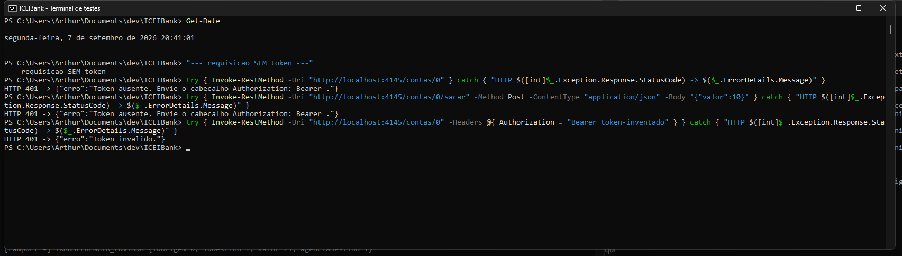 | 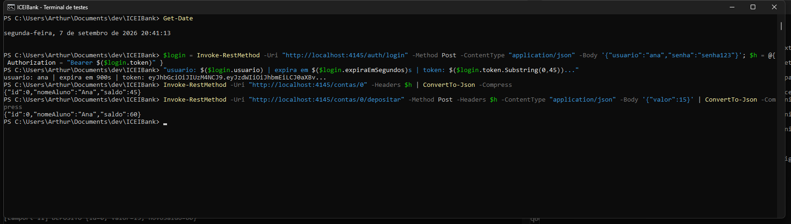 | 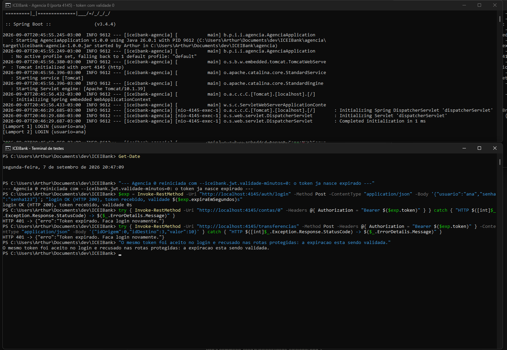 |

- **Código:**
  - rota de login: [`AuthController.java`](../01-backend-agencias/src/main/java/br/pucminas/icei/iceibank/agencia/controller/AuthController.java)
  - geração do token: [`JwtService.java` L41](../01-backend-agencias/src/main/java/br/pucminas/icei/iceibank/agencia/security/JwtService.java#L41)
  - filtro que protege as rotas (e libera `/auth` e `/bully`): [`JwtFilter.java` L43](../01-backend-agencias/src/main/java/br/pucminas/icei/iceibank/agencia/security/JwtFilter.java#L43)
  - CORS antes do JWT (senão o 401 vira "Failed to fetch"): [`CorsConfig.java` L34](../01-backend-agencias/src/main/java/br/pucminas/icei/iceibank/agencia/config/CorsConfig.java#L34)
  - usuários `ana`, `bruno`, `carla` / `senha123`: [`UsuariosEmMemoria.java`](../01-backend-agencias/src/main/java/br/pucminas/icei/iceibank/agencia/security/UsuariosEmMemoria.java)

### 2.3 Contas e transferências (local e entre agências)

- **O que falar:** "Depositar, sacar e transferir. Na transferência o débito é sempre local; se o
  destino é de outra agência, o crédito acontece lá."
- **Telas:**

  | Transferência local | Transferência entre agências |
  |---|---|
  | 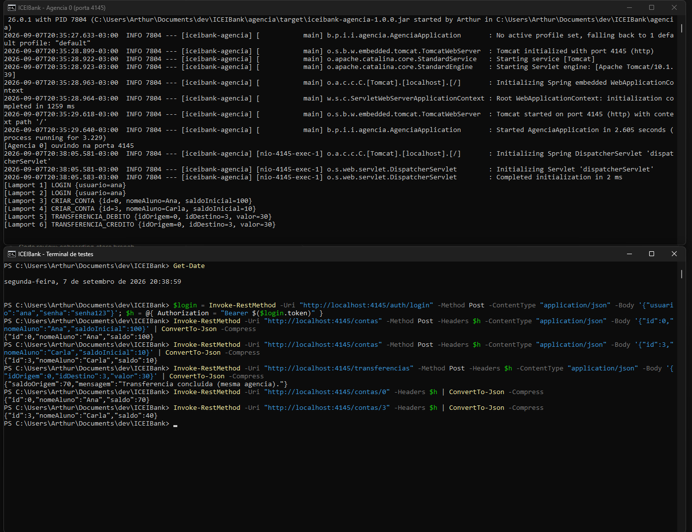 | 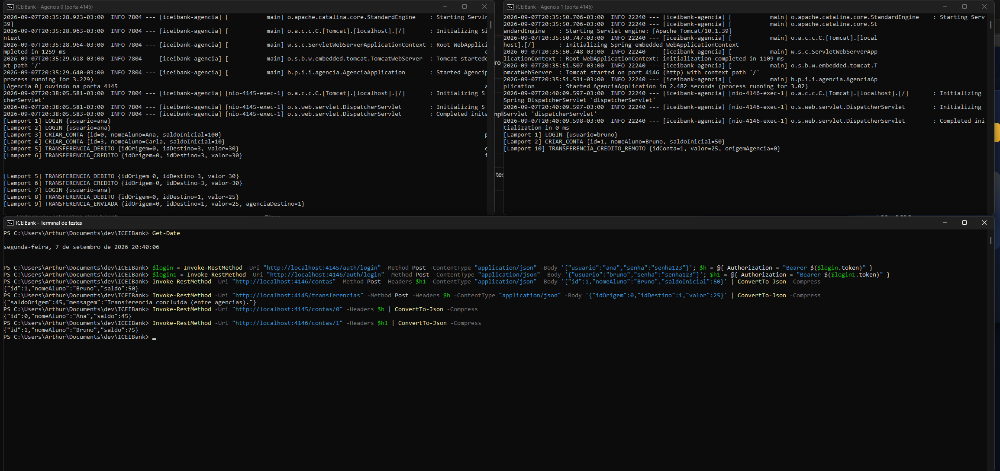 |

- **Código:**
  - CRUD de conta (criar, consultar, depositar, sacar): [`ContasController.java`](../01-backend-agencias/src/main/java/br/pucminas/icei/iceibank/agencia/controller/ContasController.java)
  - transferência: [`TransferenciasController.java` L42](../01-backend-agencias/src/main/java/br/pucminas/icei/iceibank/agencia/controller/TransferenciasController.java#L42)
    — débito local na L108, decisão "mesma agência ou outra" logo abaixo.

### 2.4 Falha conhecida (débito sem crédito)

- **O que falar:** "No Sprint 1, se a agência de destino estava fora do ar, o débito ficava e o
  crédito não acontecia: o dinheiro sumia. Era proposital, para mostrar o problema. No Sprint 2 isso
  mudou: com RabbitMQ a mensagem fica na fila e é entregue quando o destino volta; e se o próprio
  broker estiver fora, o débito é revertido." (código atual: [`TransferenciasController.java` L140](../01-backend-agencias/src/main/java/br/pucminas/icei/iceibank/agencia/controller/TransferenciasController.java#L140))
- **Tela (execução do Sprint 1):** 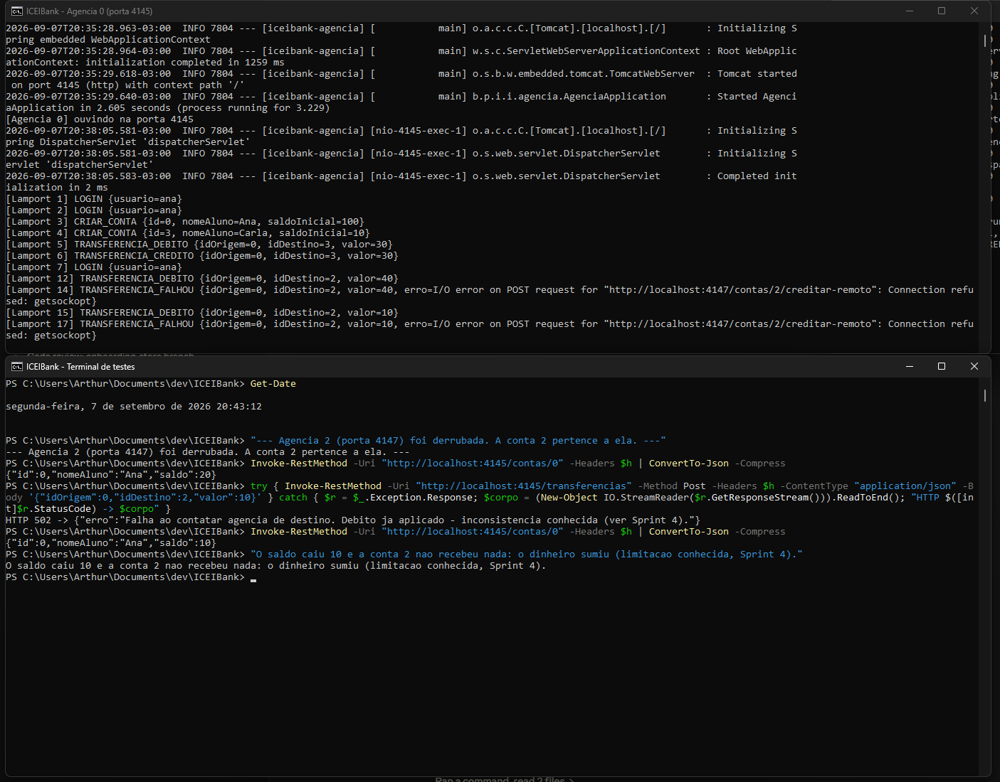

### 2.5 Relógio lógico e linha do tempo unificada

- **O que falar:** "Cada evento é carimbado com o relógio lógico e gravado num log por agência
  (`data/eventos-agencia-N.jsonl`). A ferramenta `MesclarLogs` junta os 3 logs numa linha do tempo
  só." (No Sprint 1 era Lamport; no Sprint 2 virou vetorial — ver 3.3.)
- **Tela:** 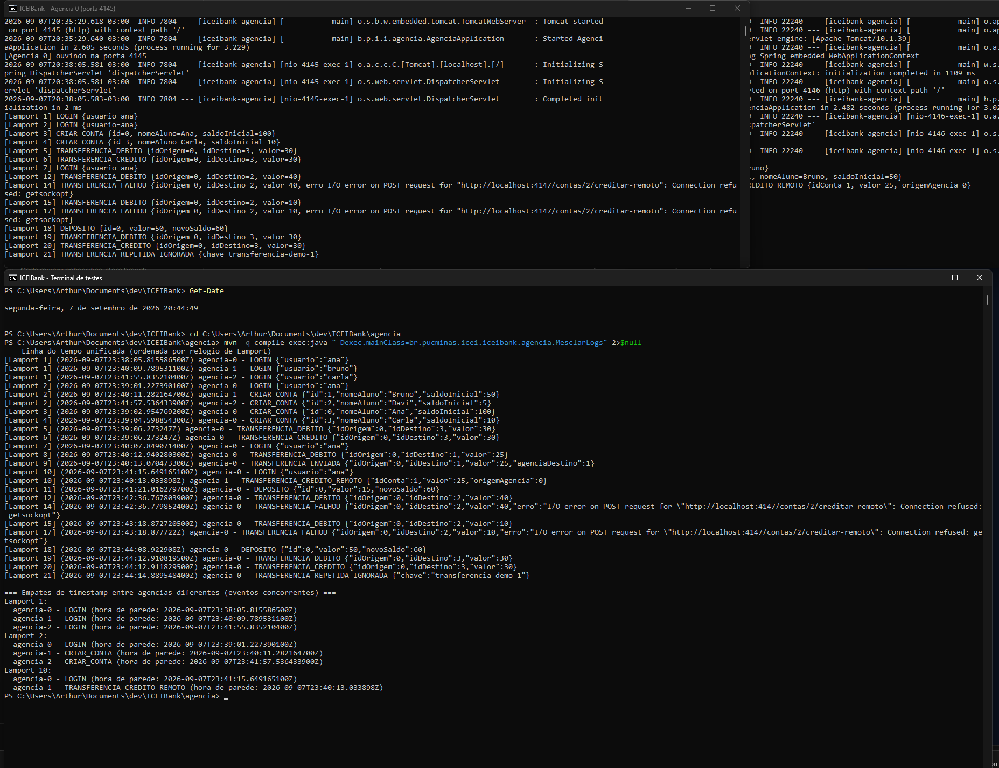
- **Código:**
  - relógio (as 3 regras, `synchronized`): [`RelogioVetorial.java` L38–L58](../01-backend-agencias/src/main/java/br/pucminas/icei/iceibank/agencia/service/RelogioVetorial.java#L38)
  - gravação do log `.jsonl`: [`RegistroEventos.java`](../01-backend-agencias/src/main/java/br/pucminas/icei/iceibank/agencia/service/RegistroEventos.java)
  - mesclagem: [`MesclarLogs.java` L80](../01-backend-agencias/src/main/java/br/pucminas/icei/iceibank/agencia/ferramentas/MesclarLogs.java#L80)
  - rodar: `scripts\linha-do-tempo.bat`

### 2.6 Frontend web (MVC)

- **O que falar:** "HTML/CSS/JS puro, sem framework, separado em Model (fetch + estado), View (DOM)
  e Controller (liga os dois). O token fica no `localStorage` e vai em todo `fetch`."
- **Telas:**

  | Login | Operações | Erro mostrado na tela |
  |---|---|---|
  | 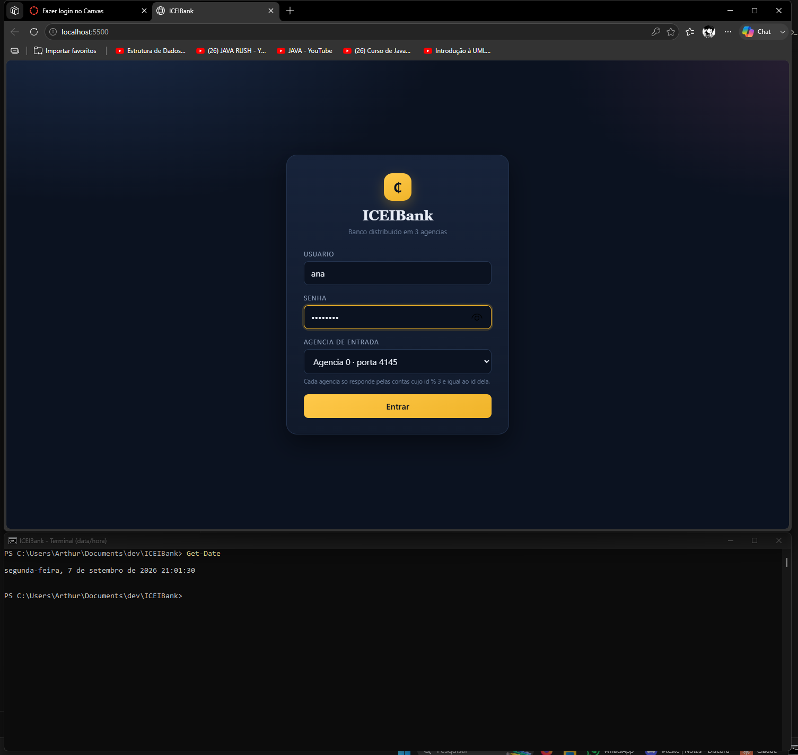 | 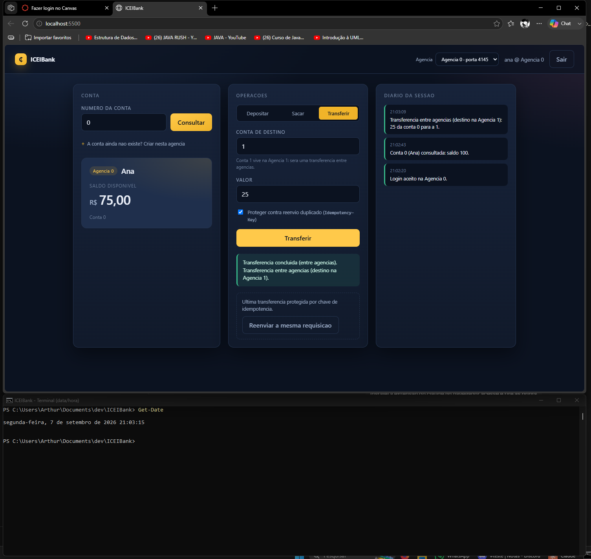 | 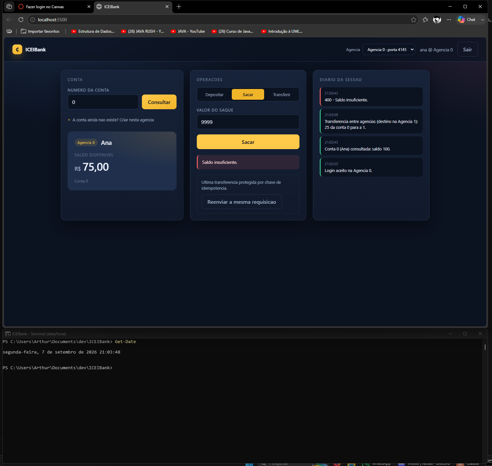 |

- **O que tem em cada arquivo (`02-frontend-web/`):**

  | Arquivo | Papel | Destaques |
  |---|---|---|
  | `index.html` | estrutura das 2 telas (login e app) | formulários de consulta, criar conta, depositar/sacar/transferir, diário da sessão |
  | `css/estilo.css` | visual | `[hidden] { display:none !important }` (bug resolvido, ver doc) |
  | `js/model.js` | **Model**: estado e chamadas HTTP | `Authorization: Bearer` em [L85](../02-frontend-web/js/model.js#L85), 401 encerra a sessão em [L103](../02-frontend-web/js/model.js#L103), `Idempotency-Key` em [L165](../02-frontend-web/js/model.js#L165) |
  | `js/view.js` | **View**: só mexe no DOM | `desenharConta`, `registrarNoDiario`, alertas |
  | `js/controller.js` | **Controller**: eventos da tela → model → view | tratamento do 401 e 502 em [L26](../02-frontend-web/js/controller.js#L26) |
  | `js/app.js` | ponto de entrada | só chama `iniciar()` |

### 2.7 Funcionalidade adicional do Sprint 1 — idempotência

- **O que falar:** "Cabeçalho `Idempotency-Key` na transferência. Se a resposta se perde e o
  cliente reenvia, a agência devolve o resultado guardado e **não debita de novo**. Mesma chave com
  corpo diferente → 409." (Botão *Reenviar a mesma requisição* no frontend.)
- **Tela:** 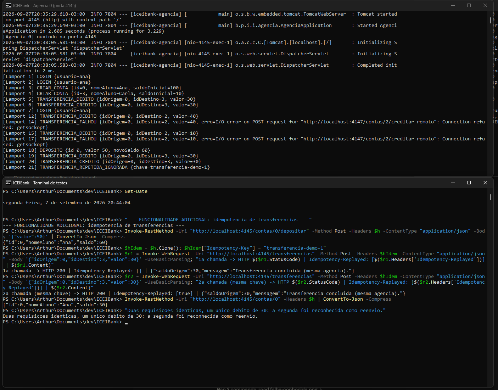
- **Código:** [`TransferenciasController.java` L42–L80](../01-backend-agencias/src/main/java/br/pucminas/icei/iceibank/agencia/controller/TransferenciasController.java#L42)

---

## 3. Sprint 2 — Mensageria (RabbitMQ) e relógio vetorial

### 3.1 Transferência assíncrona via RabbitMQ

- **O que falar:** "A transferência entre agências deixou de ser uma chamada REST. A origem publica
  uma mensagem no exchange `iceibank.eventos` com routing key `agencia.<id>.creditar`; o destino
  consome da sua fila durável `fila-agencia-<id>`. O 200 significa 'publicado', o crédito acontece
  depois."
- **Tela:** 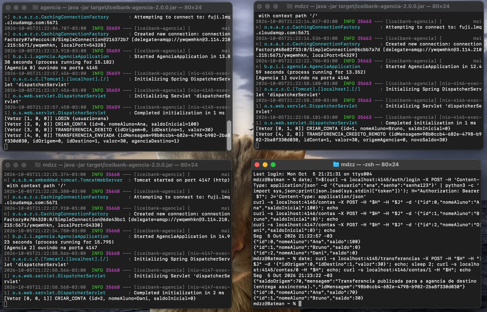
- **Código:**
  - topologia (exchange, filas, DLQ): [`MensageriaConfig.java` L63](../01-backend-agencias/src/main/java/br/pucminas/icei/iceibank/agencia/mensageria/MensageriaConfig.java#L63)
  - publicação: [`TransferenciasController.java` L138](../01-backend-agencias/src/main/java/br/pucminas/icei/iceibank/agencia/controller/TransferenciasController.java#L138) → [`PublicadorRabbit.java`](../01-backend-agencias/src/main/java/br/pucminas/icei/iceibank/agencia/mensageria/PublicadorRabbit.java)
  - consumo: [`ConsumidorCreditos.java` L25](../01-backend-agencias/src/main/java/br/pucminas/icei/iceibank/agencia/mensageria/ConsumidorCreditos.java#L25) → [`ProcessadorCreditos.java` L30](../01-backend-agencias/src/main/java/br/pucminas/icei/iceibank/agencia/service/ProcessadorCreditos.java#L30)

### 3.2 Resiliência: destino fora do ar não perde dinheiro

- **O que falar:** "Derrubo a agência de destino, transfiro, e a mensagem fica esperando na fila.
  Quando a agência volta, consome e credita. E como o RabbitMQ entrega 'pelo menos uma vez', guardo
  os ids já processados para não creditar em dobro."
- **Tela:** 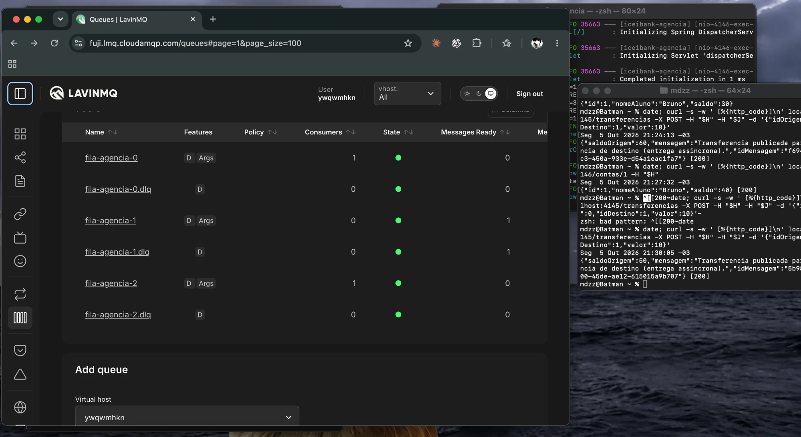
- **Código:** deduplicação por `idMensagem`: [`ProcessadorCreditos.java` L44](../01-backend-agencias/src/main/java/br/pucminas/icei/iceibank/agencia/service/ProcessadorCreditos.java#L44)

### 3.3 Relógio vetorial e eventos concorrentes

- **O que falar:** "Lamport só diz 'pode ter acontecido antes'. Com o vetor (um contador por
  agência) dá para **provar** se dois eventos são causais ou concorrentes. O `MesclarLogs` lista os
  pares comprovadamente concorrentes."
- **Tela:** 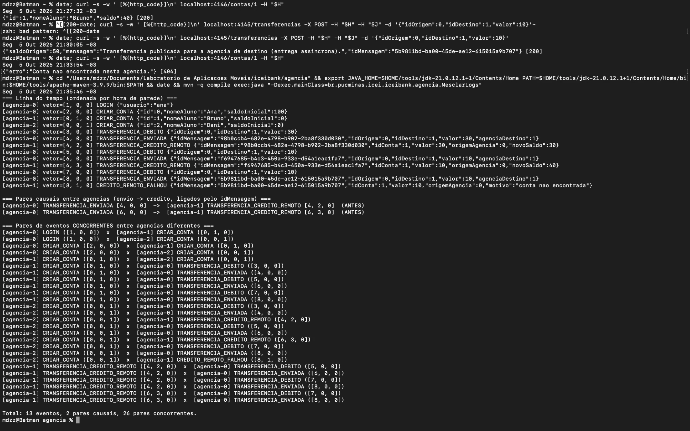
- **Código:**
  - relógio vetorial: [`RelogioVetorial.java`](../01-backend-agencias/src/main/java/br/pucminas/icei/iceibank/agencia/service/RelogioVetorial.java) (regra 3, `max` posição a posição, em L48)
  - comparação (ANTES / DEPOIS / IGUAIS / CONCORRENTES): [`ComparadorVetorial.java` L19](../01-backend-agencias/src/main/java/br/pucminas/icei/iceibank/agencia/service/ComparadorVetorial.java#L19)
  - pares concorrentes: [`MesclarLogs.java` L112](../01-backend-agencias/src/main/java/br/pucminas/icei/iceibank/agencia/ferramentas/MesclarLogs.java#L112)

### 3.4 Funcionalidade adicional do Sprint 2 — dead-letter queue

- **O que falar:** "Crédito que a agência não consegue aplicar (ex.: conta inexistente) não fica em
  loop na fila: é rejeitado e vai para `fila-agencia-<id>.dlq`, onde dá para inspecionar."
- **Tela:** 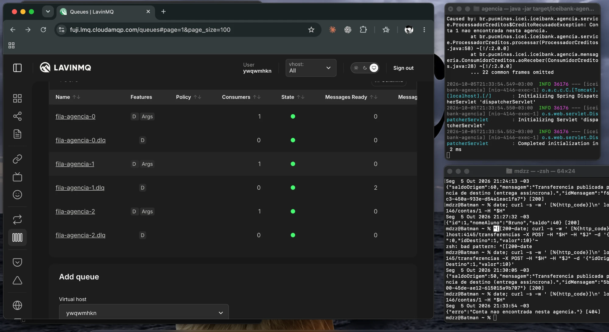
- **Código:** [`MensageriaConfig.java` L27–L51](../01-backend-agencias/src/main/java/br/pucminas/icei/iceibank/agencia/mensageria/MensageriaConfig.java#L27)

---

## 4. Sprint 3 — Eleição de líder (Bully) e app Flutter offline-first

### 4.1 Algoritmo de Bully

- **O que falar:** "Ao subir, cada agência faz uma eleição: manda `eleicao` só para as de ID maior.
  Se nenhuma maior responde, ela vira líder e anuncia com `coordenador`. Resultado: a líder é sempre
  a de **maior ID ativa** — a Agência 2."
- **Tela:** 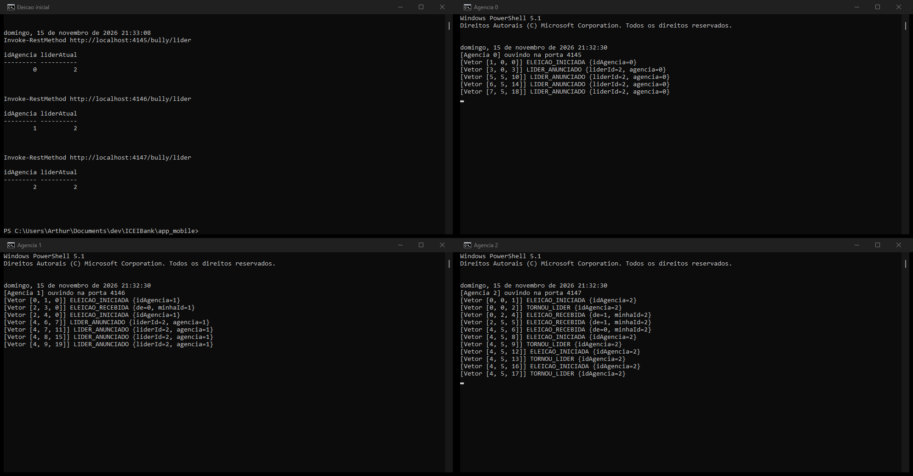
- **Código:**
  - eleição: [`BullyService.java` L108](../01-backend-agencias/src/main/java/br/pucminas/icei/iceibank/agencia/service/BullyService.java#L108)
  - virar líder e anunciar: [`BullyService.java` L130](../01-backend-agencias/src/main/java/br/pucminas/icei/iceibank/agencia/service/BullyService.java#L130)
  - receber eleição / coordenador: [`BullyService.java` L141 e L149](../01-backend-agencias/src/main/java/br/pucminas/icei/iceibank/agencia/service/BullyService.java#L141)
  - rotas `/bully/eleicao`, `/bully/coordenador`, `/bully/lider`: [`BullyController.java`](../01-backend-agencias/src/main/java/br/pucminas/icei/iceibank/agencia/controller/BullyController.java)
  - chamadas HTTP com timeout entre agências: [`HttpTransporteBully.java`](../01-backend-agencias/src/main/java/br/pucminas/icei/iceibank/agencia/service/HttpTransporteBully.java)

### 4.2 Heartbeat e failover automático

- **O que falar:** "A cada 3 s cada agência pergunta à líder se está viva. Sem resposta em 1 s,
  registra `LIDER_NAO_RESPONDEU` e começa nova eleição. Derrubei a Agência 2 e a 1 assumiu sozinha."
- **Tela:** 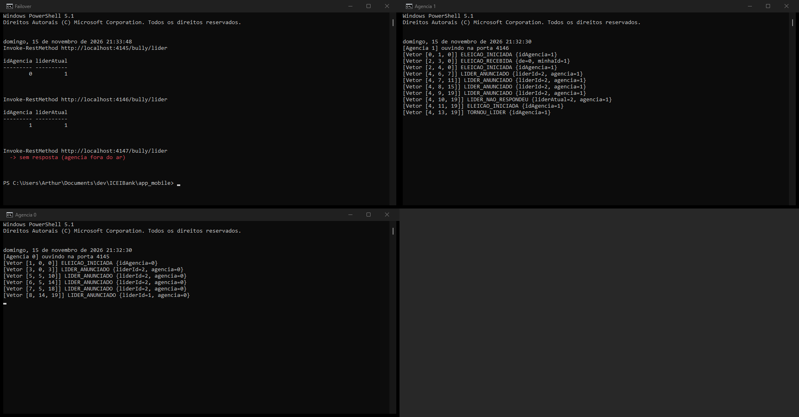
- **Código:** agendamento em [`BullyService.java` L72](../01-backend-agencias/src/main/java/br/pucminas/icei/iceibank/agencia/service/BullyService.java#L72), verificação em [L89](../01-backend-agencias/src/main/java/br/pucminas/icei/iceibank/agencia/service/BullyService.java#L89); tempos em [`application.properties`](../01-backend-agencias/src/main/resources/application.properties)

### 4.3 Histórico de lideranças

- **O que falar:** "Os eventos de eleição vão para o mesmo log com vetor. A ferramenta
  `HistoricoLideranca` reconstrói quem foi líder e quando."
- **Tela:** 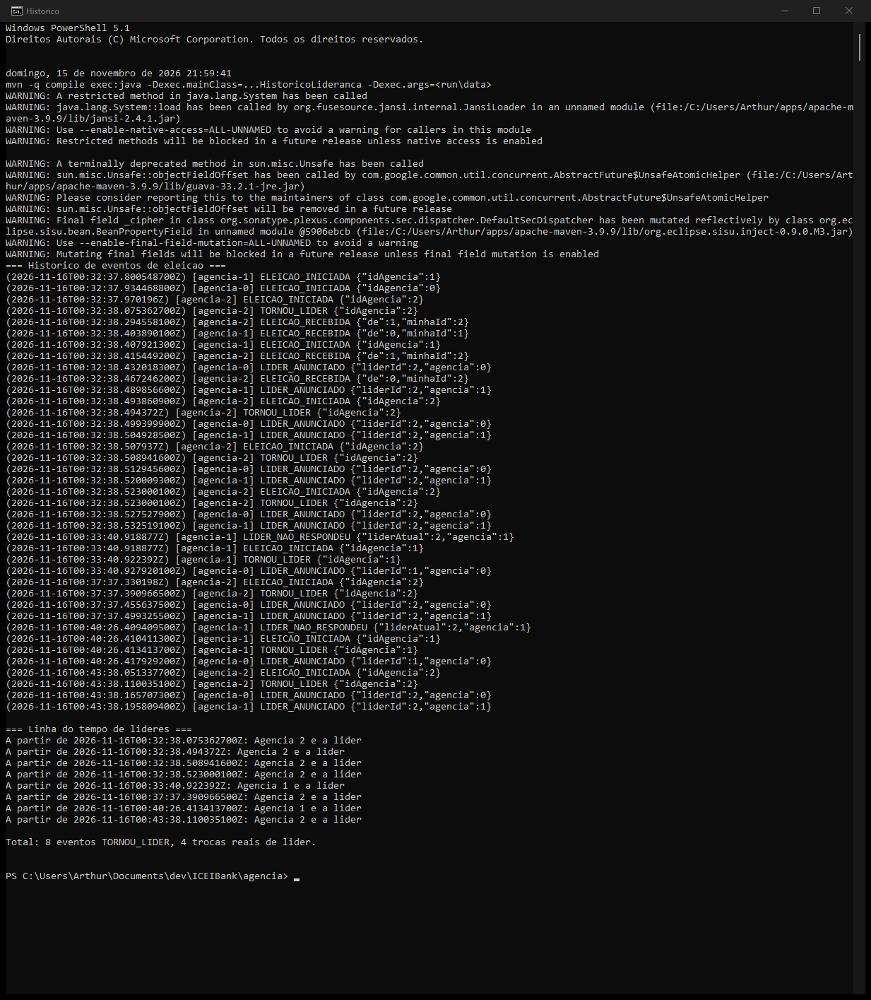
- **Código:** [`HistoricoLideranca.java`](../01-backend-agencias/src/main/java/br/pucminas/icei/iceibank/agencia/ferramentas/HistoricoLideranca.java) — rodar: `scripts\historico-lideranca.bat`

### 4.4 Sincronização offline-first no backend (detecção de conflito com vetor)

- **O que falar:** "O app guarda o vetor que viu (`vetorConhecido`). Ao reconectar, manda a operação
  pendente com esse vetor. Se o vetor da agência mudou, alguém mexeu enquanto o app estava offline:
  a agência recusa com **409** e devolve o saldo real. É o mesmo princípio do *optimistic locking*."
- **Tela:** 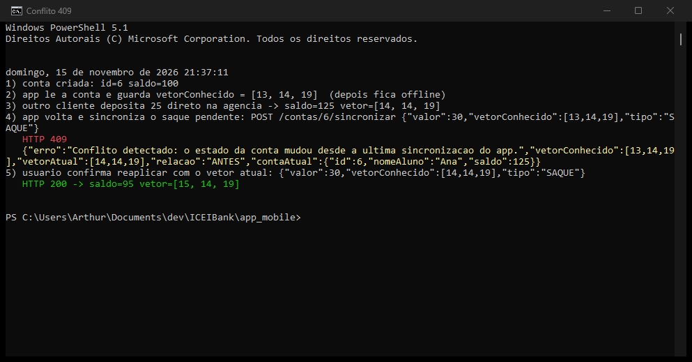
- **Código:**
  - endpoint: [`ContasController.java` L117](../01-backend-agencias/src/main/java/br/pucminas/icei/iceibank/agencia/controller/ContasController.java#L117)
  - "aplica só se o vetor for igual" (atômico): [`RelogioVetorial.java` L69](../01-backend-agencias/src/main/java/br/pucminas/icei/iceibank/agencia/service/RelogioVetorial.java#L69)

### 4.5 App Flutter

- **O que falar:** "Mesmo fluxo do frontend (login, saldo, depósito, saque, transferência, criar
  conta) e, em cima, o painel da líder atual, que consulta as 3 agências a cada 3 s."
- **Telas:**

  | Líder atual | Failover visto no app |
  |---|---|
  | 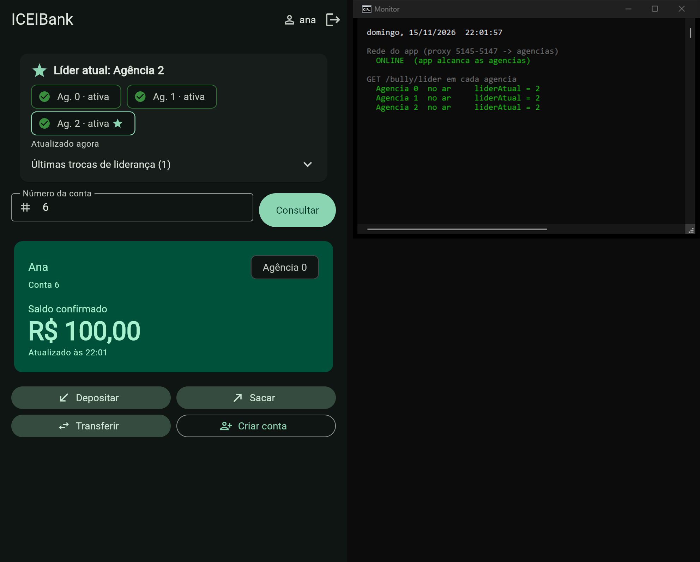 | 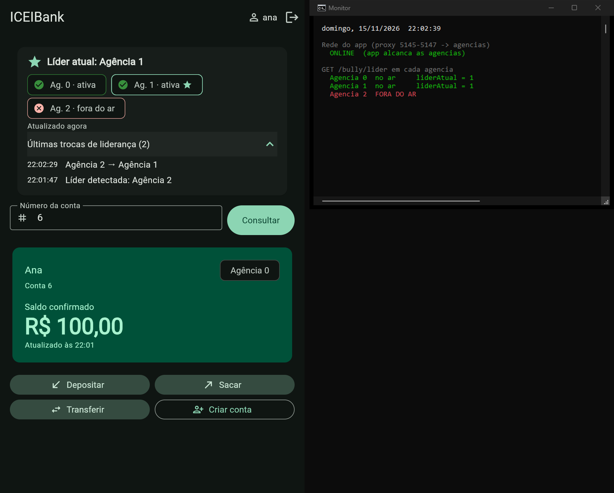 |

- **Modo offline (fila local, saldo provisório, sincronização e conflito):**

  | Offline (pendente) | Sincronizado | Conflito 409 | Reaplicado |
  |---|---|---|---|
  | 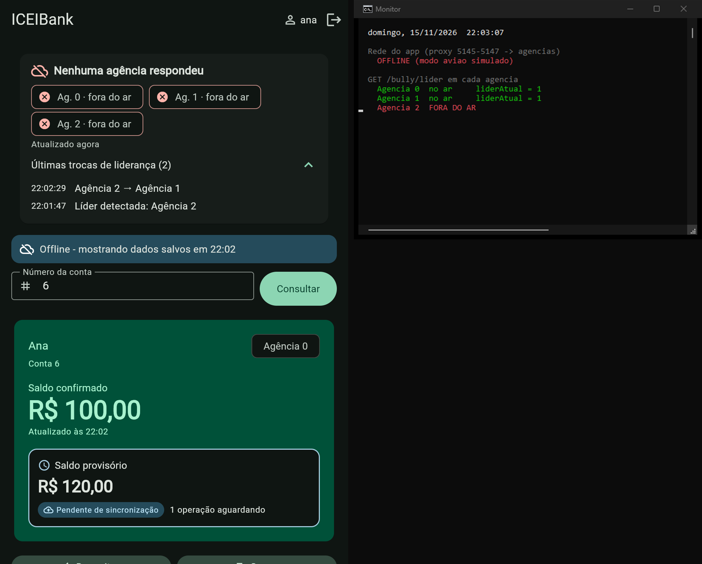 | 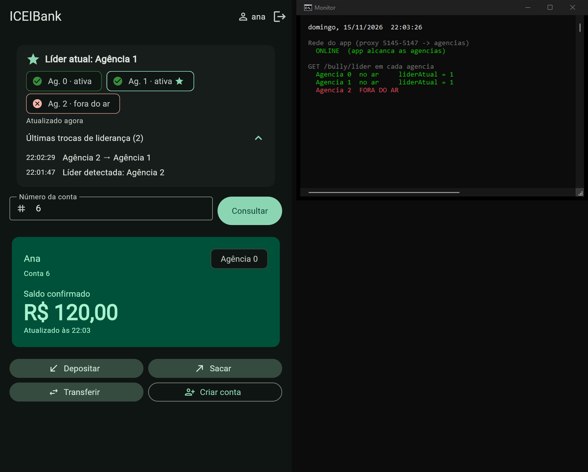 | 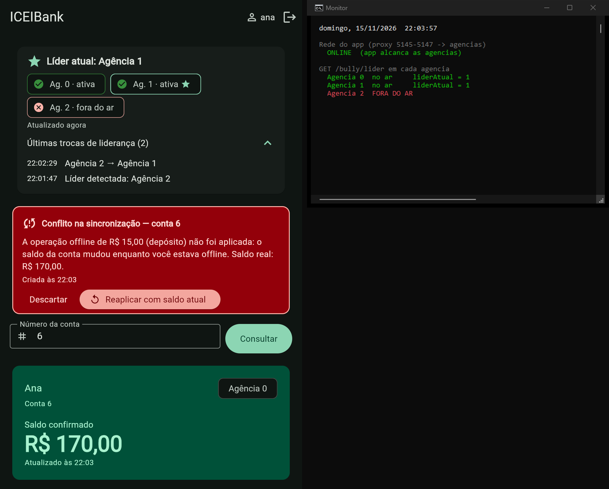 | 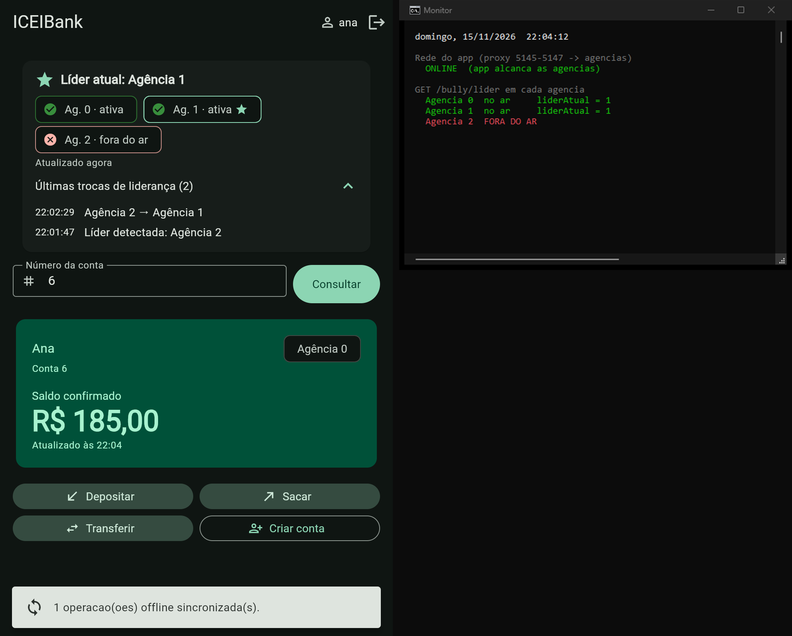 |

- **O que tem em cada arquivo (`03-app-mobile-flutter/lib/`):**

  | Arquivo | Papel | Destaques |
  |---|---|---|
  | `main.dart` | inicializa Hive, serviços e navegação login ↔ principal | montagem em [L18–L24](../03-app-mobile-flutter/lib/main.dart#L18) |
  | `config.dart` | endereços das agências (`10.0.2.2` no emulador), timeouts, intervalo do polling | espelha `ConfigAgencias.java` |
  | `models.dart` | `ContaRemota`, `OperacaoPendente`, `RespostaLider` | status `PENDENTE` / `CONFLITO` / `RECUSADA` |
  | `api/api_client.dart` | todas as chamadas HTTP com JWT | 409 vira `ConflitoSincronizacaoException` em [L118](../03-app-mobile-flutter/lib/api/api_client.dart#L118) |
  | `api/excecoes.dart` | erros tipados (sem conexão, API, conflito) | |
  | `offline/armazenamento_local.dart` | **Hive**: cache de saldo + vetor, fila de pendentes, sessão | |
  | `offline/servico_contas.dart` | **coração do offline-first** | sincroniza fila em [L198](../03-app-mobile-flutter/lib/offline/servico_contas.dart#L198), detecta volta da rede em [L308](../03-app-mobile-flutter/lib/offline/servico_contas.dart#L308), descartar/tentar de novo em [L287](../03-app-mobile-flutter/lib/offline/servico_contas.dart#L287) |
  | `lideranca/lideranca_service.dart` | polling das 3 agências a cada 3 s, agências ativas, histórico | [L65](../03-app-mobile-flutter/lib/lideranca/lideranca_service.dart#L65) e [L98](../03-app-mobile-flutter/lib/lideranca/lideranca_service.dart#L98) |
  | `lideranca/painel_lideranca.dart` | widget do painel (estrela na líder, chips verdes/vermelhos) | |
  | `telas/tela_login.dart` | tela de login | |
  | `telas/tela_principal.dart` | tela principal: painel, faixa online/offline, conflito, saldo, pendentes | [L350–L386](../03-app-mobile-flutter/lib/telas/tela_principal.dart#L350) |
  | `telas/widgets/cartao_saldo.dart` | saldo confirmado × **provisório** (com selo) | |
  | `telas/widgets/cartao_conflito.dart` | cartão vermelho do 409 com **Reaplicar** / **Descartar** | |
  | `telas/widgets/lista_pendentes.dart` | lista da fila local | |
  | `telas/widgets/dialogos.dart` | diálogos de valor, transferência, nova conta | |
  | `telas/widgets/formatos.dart` | formatação de R$ e validação | |

### 4.6 Funcionalidade adicional do Sprint 3 — agências ativas + histórico no app

- **O que falar:** "O painel mostra quais das 3 agências responderam na última rodada (chip verde ou
  vermelho) e a lista das trocas de líder que o app observou."
- **Tela:** 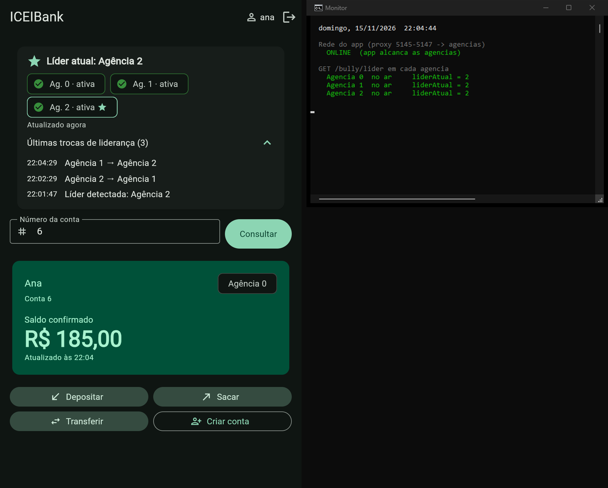
- **Código:** [`lideranca_service.dart` L98–L125](../03-app-mobile-flutter/lib/lideranca/lideranca_service.dart#L98) e [`painel_lideranca.dart`](../03-app-mobile-flutter/lib/lideranca/painel_lideranca.dart)

---

## 5. Testes automatizados

- **O que falar:** "São 89 testes JUnit no backend (sem precisar de RabbitMQ no ar) e testes Dart no
  app. Exemplo: o teste do relógio dispara várias threads e prova que o `synchronized` evita perder
  incremento."
- **Rodar:** `scripts\rodar-testes.bat` (backend) — `flutter test` dentro de `03-app-mobile-flutter`.
- **Onde:** `01-backend-agencias/src/test/java/...` (um `*Test.java` por classe principal) e
  `03-app-mobile-flutter/test/`.

---

## 6. Perguntas que o professor pode fazer (respostas curtas)

| Pergunta | Resposta curta | Detalhe |
|---|---|---|
| Por que porta 4145 e não 4045? | 4045 é bloqueada por Chrome/Firefox (`ERR_UNSAFE_PORT`) | `RESPOSTAS.md` §0.1 |
| Por que JWT não precisa de banco? | a assinatura com a chave secreta prova que o token é válido | `RESPOSTAS.md` §5.4 |
| Lamport basta para saber se é concorrente? | não; só o vetor prova concorrência | `RESPOSTAS.md` §4.3 e S2.3 |
| O que acontece se a mesma mensagem chegar 2 vezes? | é ignorada pelo `idMensagem` (`CREDITO_DUPLICADO_IGNORADO`) | §3.2 deste guia |
| Por que a líder é sempre a 2? | Bully: vence a de maior ID entre as ativas | §4.1 |
| E se a rede estiver lenta e não morta? | pode haver duas líderes (split-brain); Bully assume rede síncrona | `ENTENDENDO-O-PROJETO.md` §12.6 |
| Por que Hive no app? | puro Dart, chave-valor, sem SQL: suficiente para cache + fila | `RESPOSTAS.md` S3.7 |
| Por que o conflito não é resolvido automático? | em dinheiro, quem decide é a pessoa: Reaplicar ou Descartar | `RESPOSTAS.md` S3.7 |
| Por que às vezes dá 409 sem conflito real? | o vetor é por agência, não por conta: falha para o lado seguro | `ENTENDENDO-O-PROJETO.md` §12.6 |

Respostas completas de todas as questões do roteiro: [`RESPOSTAS.md`](RESPOSTAS.md).
Explicação narrativa do projeto inteiro: [`ENTENDENDO-O-PROJETO.md`](ENTENDENDO-O-PROJETO.md).
